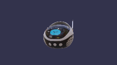
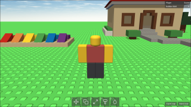
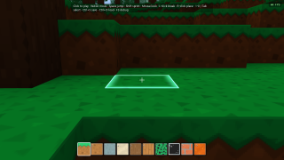
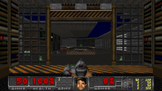
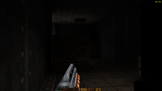
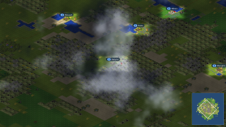

# Babylon Lite Native

`bblitec` compiles a bounded Babylon Lite TypeScript subset to C++20 that runs natively on SDL3 with SDL_GPU or Dawn.

|  |  |  |  |
| :-: | :-: | :-: | :-: |
|  |  |  |  |

Source pin: [upstream/babylon-lite.json](upstream/babylon-lite.json). Start with [setup](docs/development.md#setup).

## Documentation

| Page | Owns |
| --- | --- |
| [Repository instructions](.github/copilot-instructions.md) | Working rules |
| [Architecture](docs/architecture.md) | Pipeline, code ownership, runtime memory |
| [Features](docs/features.md) | Admitted source surface and its limits |
| [UI](docs/ui.md) | DOM/CSS/Canvas2D surface and limits |
| [Fidelity](docs/fidelity.md) | Native deviations from the browser reference |
| [Backends](docs/backends.md) | GPU backends, bindings, threading |
| [Development](docs/development.md) | Setup, commands, builds, validation |
| [Debugging](docs/debugging.md) | Measurement, diagnosis, runtime switches |
| [Status](docs/status.md) | Published measurements |
| [TODO](TODO.md) | Internal work and qualification |

## Acknowledgements

Not affiliated with or endorsed by Babylon.js. Babylon Lite and third-party libraries/assets keep their licenses;
see packaged notices.
